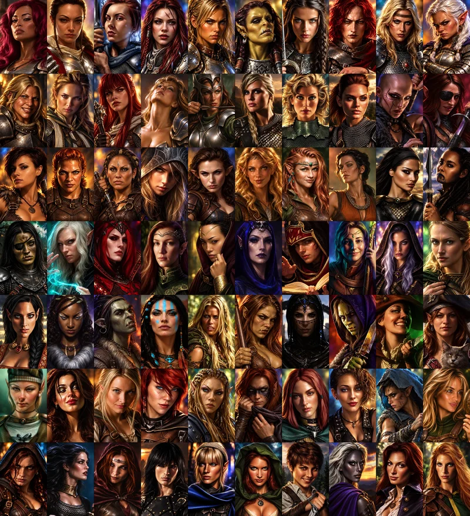
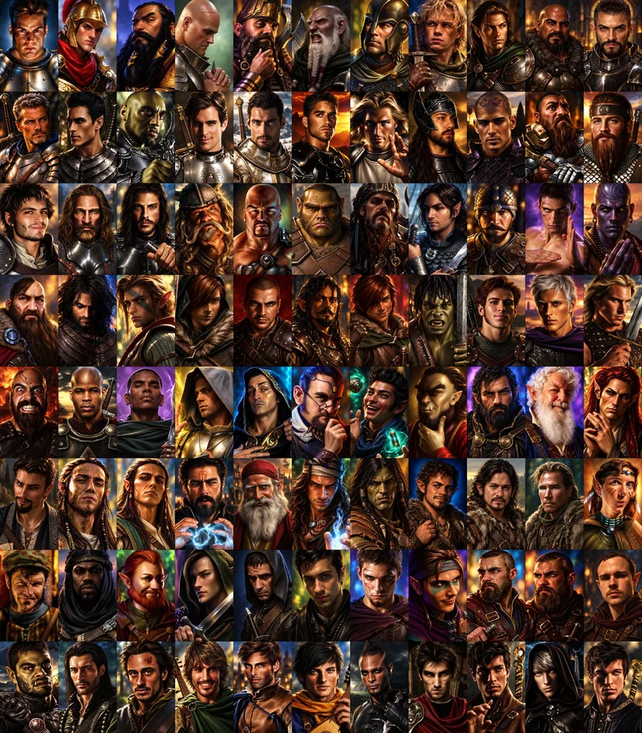
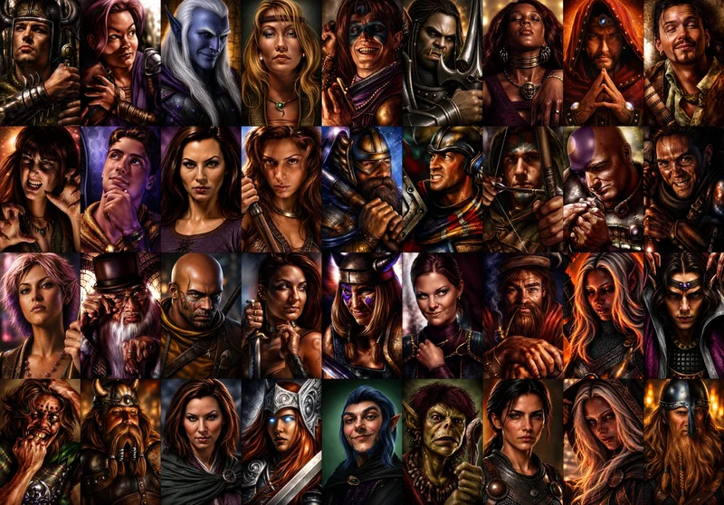
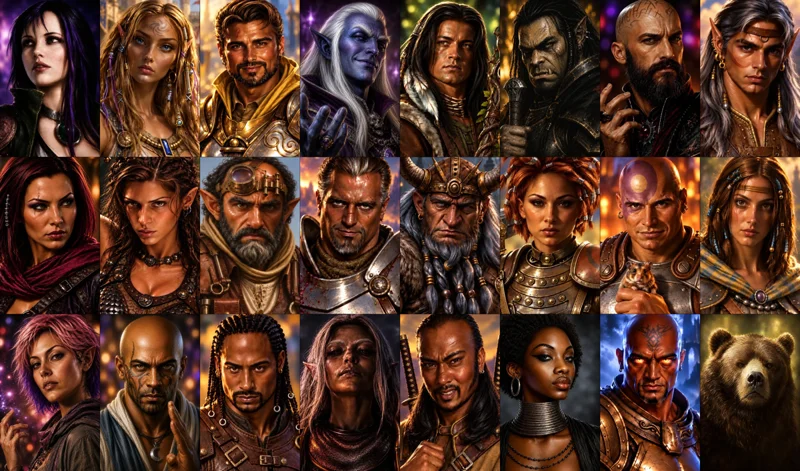
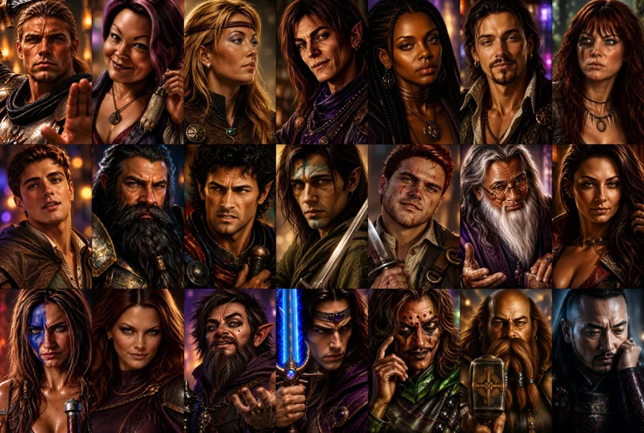
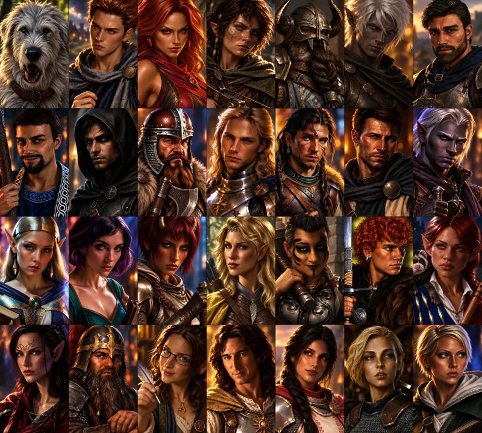
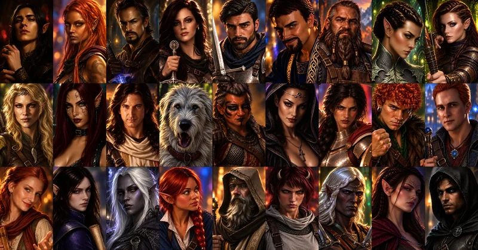



# BG1 Style Portraits
*BG1-style portraits for BG:EE, BG2:EE and EET.*

## Overview

This WeiDU mod aims to improve the quality and consistency of PC and NPC portraits, especially in EET. The target for 1.0.0 is to cover all vanilla party NPCs, big number of modded party NPCs, and upgrade/expand the PC portrait collection. After that, I will focus on adding the major non-party NPC portraits.

The mod supports the vanilla EE UI, LeUI, and Infinity UI++, however it's best suited for the latter.

## Installation order and mod compatibility

This is a portrait mod and should be installed after content mods that install new NPCs or quests. I suggest to install it as the last mod to make it possible to easy reinstall it on new versions release. It should be installed after The HPS Portraits Project so it will overwrite some of the portraits. 

There are no compatibility issues known with other mods.

1. Extract the mod to your game or EET mod folder.
2. Run `setup-BG1StylePortraits.exe` (or install via WeiDU against `BG1StylePortraits/BG1StylePortraits.tp2`).
3. Select the components you want at install time.

## Components

Each portrait uses three size variants:

- **M** - in-game (downscaled L)
- **L** - character record/inventory (base portrait)
- **r** - additional portrait at the Infinity UI inventory screen (zoomed out)

### Player Character: Replace PC Portraits *(BG:EE, BG2:EE, and EET)*

This single component clears all existing entries from the player portrait list and add new collection. 
The sources of the new portraits are: Isandir's portraits, NwN portraits, PoE portraits and other portraits posted on Beamdog forum as propositions for creating PC portraits. If you spot any copyrighted one, please let me know.

When upgrading from an older version with separate portrait-pack and NPC-removal components, uninstall both old PC components before replacing the mod files. The combined component keeps number 1001; component 1901 has been retired.

### Party NPC: Enhanced BG1 NPC Portraits *(BG:EE, BG2:EE, and EET)*

This component replaces portraits for 36 recruitable NPCs with enhanced BG1-style art.

The majority of the portraits are simply upscaled and enhanced versions of the originals (with added details and lore-accurate fixes, such as removing the pointy ears from the halfling portraits or giving Viconia white hair).
However, a few more controversial decisions were made:

- Faldorn no longer looks like a vampiric Meryl Streep.
- Imoen received a more extensive rework than the others, as I always felt her original portrait was rushed and somewhat disappointing.
- Xan's face was dehumanized.
- Viconia's face got changed to be consistent through the saga 

See the [BG1 portrait gallery](docs/gallery_bg1.md) for individual portraits.

### Party NPC: New BG2 NPC Portraits *(BG2:EE and EET)*

This component replaces portraits for recruitable BG2 NPCs with enhanced BG1-style art. I will be adding more portraits in the future.

The controversies:

- Edwin, without the hood, with Red Wizards tattoos on his head instead.
- Viconia's portrait is completely different, trying to match the previous portraits.

See the [BG2 portrait gallery](docs/gallery_bg2.md) for individual portraits.

### Party NPC: Returning NPC Portraits *(BG2:EE and EET)*

This component replaces portraits for modded returning BG1 NPCs in BG2 (special guest: ToB Yoshimo from Yoshimo's Remorse) with enhanced BG1-style art.
It affects whatever NPC version you installed before: standalone mods, BG1 NPCs for SoA&ToB, Continous NPCs (although the last one has not been tested yet).
The design idea is to present them without any helmets/caps as other BG2 portraits (except Korgan).

See the [Returning portrait gallery](docs/gallery_returning.md) for individual portraits.

### Mods: BG1 NPC Portraits *(BG:EE, BG2:EE, and EET)*

This component replaces portraits for mod-added BG1 NPCs with enhanced BG1-style art.

The original portrait authors are:
- Glam's Portrait Pack - __Glam or unknown__
- Brage, Brandock, Husam, Helga, Kale, Grey - __Acifer__
- Tutorial Party, Drake, K'vel, Sirene - __TheArtisan__
- Emily, Recorder - __Nicole__ 
- Vienxay - __Crisshasart__
- Finch - __unknown, possibly Bons__
- Gavin - __K’aeloree__
- Isra - __Lady Lesathoa__
- Ophysia - __Llewren__
- Valerie - __Hannah Wallace__

See the [BG1 mod NPC portrait gallery](docs/gallery_bg1_mods.md) for individual portraits.

### Mods: BG2 NPC Portraits *(BG2:EE and EET)*

This component replaces portraits for mod-added BG2 NPCs with enhanced BG1-style art.

The original portrait authors are:
- Adrian - **MiLeah**
- Amber - **Lorraine's portrait edit by Sirick**
- Angelo - **wonnimchunha**
- Auren - **Karsten Dahl**
- Brage, Brandock, Husam, Helga, Kale, Grey - __Acifer__
- Emily, Recorder - __Nicole__
- Vienxay - __Crisshasart__
- Deheriana - **unknown**
- Ela - **Serene Yoshiko**
- Fade - **Lesatho**
- Ninde - **wonnimchunha**
- Kelsey - **Karse Soze**
- Keto - **Bonnie Rutledge**
- Minyae - **Oksana Che**
- Pai'Na, Sirene - **TheArtisan**
- Saradas - **unknown or Saradas**
- Solaufein - **Chinasky**
- Gavin - **K’aeloree**
- Isra - **Lady Lesathoa**

See the [BG2 mod NPC portrait gallery](docs/gallery_bg2_mods.md) for individual portraits.

## Credits/thanks

- **Wombat** - main inspiration to BG1ize all the portraits
- **Vasculio** - base/ideas for BG1 portraits enhancements
- **DosEquis** - base/ideas for BG1 portraits enhancements
- **Kensei_xXx** - base/ideas for BG1 and PC portraits enhancements
- **Isandir** - original PC portrait pack
- **Argent77** - exact code for the EE BG2 NPC portrait replacements
- **all the original portrait authors mentioned before**
- **smeagolheart** - code for introducing Edwina portrait
- **ALIEN, Argent77, Bubb, CamDawg, DavidW, GraionDilach, K4thos, jastey, Pecca, Acifer and others** - without their effort there would be no sense in modding the 30 years old game.
- **shaigan** - the mod author

