# BG1 NPC Portrait Gallery

[← Back to README](../README.md)

The gallery shows two portrait variants:

- **L** - character record/inventory (base portrait)
- **r** - additional portrait at the Infinity UI inventory screen (zoomed out)

Click a thumbnail to view the full-size portrait.

| L | r | L | r |
|:---:|:---:|:---:|:---:|
| **Ajantis** |  | **Alora** |  |
|  | [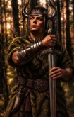](portraits/party_bg1/ajantisr.webp) | [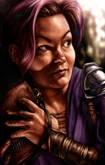](portraits/party_bg1/ALORAL.webp) |  |
| **Baeloth** |  | **Branwen** |  |
|  | [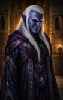](portraits/party_bg1/baelothr.webp) |  | [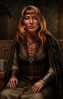](portraits/party_bg1/branwer.webp) |
| **Caelar** |  | **Coran** |  |
|  |  |  |  |
| **Dorn** |  | **Dynaheir** |  |
|  | [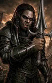](portraits/party_bg1/dornr.webp) |  |  |
| **Edwin** |  | **Eldoth** |  |
|  |  |  |  |
| **Faldorn** |  | **Garrick** |  |
|  | [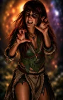](portraits/party_bg1/faldornr.webp) |  |  |
| **Glint** |  | **Imoen SoD** |  |
|  |  |  |  |
| **Imoen** |  | **Jaheira** |  |
|  |  |  |  |
| **Kagain** |  | **Khalid** |  |
|  |  |  | [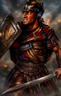](portraits/party_bg1/khalidr.webp) |
| **Kivan** |  | **M'Khiin** |  |
|  |  | [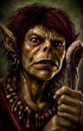](portraits/party_bg1/MKHIINL.webp) | [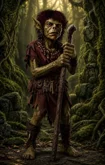](portraits/party_bg1/mkhiinr.webp) |
| **Minsc** |  | **Montaron** |  |
|  |  |  |  |
| **Neera** |  | **Quayle** |  |
|  |  |  |  |
| **Rasaad** |  | **Safana** |  |
|  |  |  | [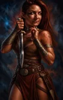](portraits/party_bg1/safanar.webp) |
| **Schael** |  | **Shar-Teel** |  |
|  |  |  | [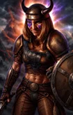](portraits/party_bg1/shartelr.webp) |
| **Skie** |  | **Tiax** |  |
|  | [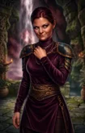](portraits/party_bg1/skier.webp) | [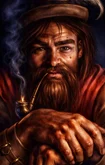](portraits/party_bg1/TIAXL.webp) | [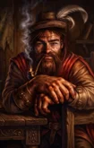](portraits/party_bg1/tiaxr.webp) |
| **Viconia SoD** |  | **Viconia** |  |
|  |  |  | [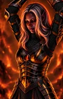](portraits/party_bg1/viconiar.webp) |
| **Voghiln** |  | **Xan** |  |
|  |  |  | [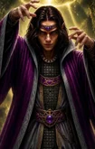](portraits/party_bg1/xanr.webp) |
| **Xzar** |  | **Yeslick** |  |
|  | [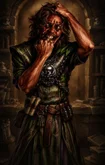](portraits/party_bg1/xzarr.webp) | [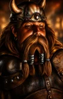](portraits/party_bg1/YESLICKL.webp) |  |
