# BG1 Mod NPC Portrait Gallery

[← Back to README](../README.md)

The gallery shows two portrait variants:

- **L** - character record/inventory (base portrait)
- **r** - additional portrait at the Infinity UI inventory screen (zoomed out)

Click a thumbnail to view the full-size portrait.

| L | r | L | r |
|:---:|:---:|:---:|:---:|
| **Arkanis** |  | **Brage** |  |
|  |  |  |  |
| **Brandock** |  | **Breagar** |  |
|  |  |  |  |
| **Canderous** |  | **Dave** |  |
|  |  | [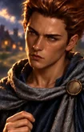](portraits/party_bg1_mods/SDAVEL.webp) | [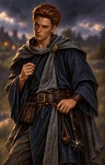](portraits/party_bg1_mods/sdaver.webp) |
| **Deder** |  | **Drake** |  |
|  | [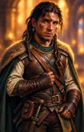](portraits/party_bg1_mods/sdederr.webp) |  |  |
| **Emily** |  | **Finch** |  |
| [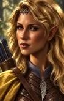](portraits/party_bg1_mods/SEMILYL.webp) |  |  |  |
| **Flara** |  | **Gavin** |  |
|  |  |  | [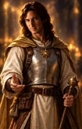](portraits/party_bg1_mods/sgavinr.webp) |
| **Helga** |  | **Husam** |  |
|  | [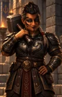](portraits/party_bg1_mods/shelgar.webp) |  |  |
| **Isra** |  | **K'Vel** |  |
|  |  |  |  |
| **Kale** |  | **Littlun** |  |
|  |  |  | [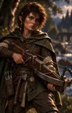](portraits/party_bg1_mods/slittlur.webp) |
| **Moidre** |  | **Mordaine** |  |
| [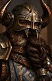](portraits/party_bg1_mods/SMOIDREL.webp) | [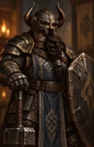](portraits/party_bg1_mods/smoidrer.webp) |  | [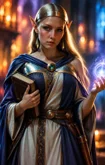](portraits/party_bg1_mods/smordair.webp) |
| **Ophysia** |  | **Osprey** |  |
|  |  |  |  |
| **Recorder** |  | **Sirene** |  |
|  |  |  | [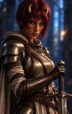](portraits/party_bg1_mods/ssirenr.webp) |
| **Valerie** |  | **Vienxay** |  |
|  |  |  | [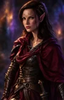](portraits/party_bg1_mods/svienxar.webp) |
| **Vynd** |  | **Verr'Sza** |  |
|  | [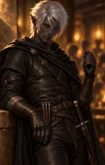](portraits/party_bg1_mods/svyndr.webp) | [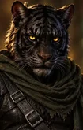](portraits/party_bg1_mods/SVERRSZL.webp) | [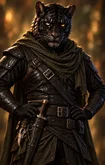](portraits/party_bg1_mods/sverrszr.webp) |
| **Grey** |  | |  |
|  |  | | |

SVERRSZ