# BG2 NPC Portrait Gallery

[← Back to README](../README.md)

The gallery shows two portrait variants:

- **L** - character record/inventory (base portrait)
- **r** - additional portrait at the Infinity UI inventory screen (zoomed out)

Click a thumbnail to view the full-size portrait.

| L | r | L | r |
|:---:|:---:|:---:|:---:|
| **Aerie** |  | **Anomen** |  |
|  |  |  |  |
| **Baeloth** |  | **Cernd** |  |
|  |  |  |  |
| **Clara** |  | **Dorn** |  |
|  |  |  | [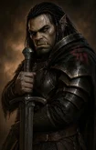](portraits/party_bg2/ndornr.webp) |
| **Edwin** |  | **Haer'Dalis** |  |
|  |  | [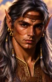](portraits/party_bg2/NHAERL.webp) |  |
| **Hexxat** |  | **Imoen** |  |
|  |  |  |  |
| **Jaheira** |  | **Jan** |  |
|  |  |  | [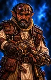](portraits/party_bg2/njanr.webp) |
| **Keldorn** |  | **Korgan** |  |
|  | [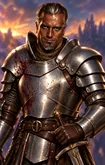](portraits/party_bg2/nkeldorr.webp) | [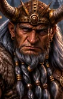](portraits/party_bg2/NKORGANL.webp) |  |
| **Mazzy** |  | **Minsc** |  |
| [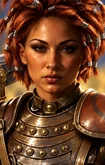](portraits/party_bg2/NMAZZYL.webp) | [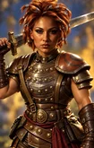](portraits/party_bg2/nmazzyr.webp) |  |  |
| **Nalia** |  | **Neera** |  |
| [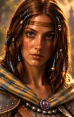](portraits/party_bg2/NNALIAL.webp) | [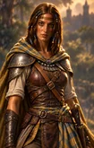](portraits/party_bg2/nnaliar.webp) |  |  |
| **Rasaad** |  | **Sarevok** |  |
|  |  |  | [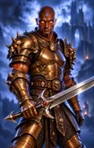](portraits/party_bg2/sarevokr.webp) |
| **Valygar** |  | **Viconia** |  |
|  | [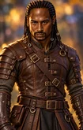](portraits/party_bg2/nvalygr.webp) | [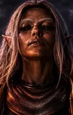](portraits/party_bg2/NVICONL.webp) | [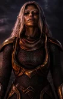](portraits/party_bg2/nviconr.webp) |
| **Wilson** |  | **Yoshimo** |  |
|  |  |  |  |
