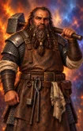
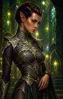
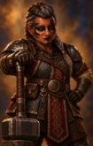
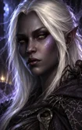
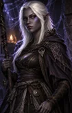
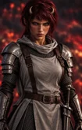

# BG2 Mod NPC Portrait Gallery

[← Back to README](../README.md)

The gallery shows two portrait variants:

- **L** - character record/inventory (base portrait)
- **r** - additional portrait at the Infinity UI inventory screen (zoomed out)

Click a thumbnail to view the full-size portrait.

| L | r | L | r |
|:---:|:---:|:---:|:---:|
| **Adrian** |  | **Amber** |  |
|  |  |  |  |
| **Angel** |  | **Auren** |  |
|  |  |  |  |
| **Brage** |  | **Brandock** |  |
|  |  |  |  |
| **Breagar** |  | **Deheriana** |  |
|  |  |  |  |
| **Ela** |  | **Emily** |  |
|  |  |  |  |
| **Fade** |  | **Gavin** |  |
|  |  |  |  |
| **Helga** |  | **Husam** |  |
|  |  |  |  |
| **Isra** |  | **Kale** |  |
|  |  |  |  |
| **Kelsey** |  | **Keto** |  |
|  |  |  |  |
| **Minyae** |  | **Ninde** |  |
|  |  |  |  |
| **Pai'na** |  | **Recorder** |  |
|  |  |  |  |
| **Saradas** |  | **Sirene** |  |
|  |  |  |  |
| **Solaufein** |  | **Vienxay** |  |
|  |  |  |  |
