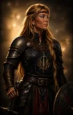
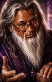
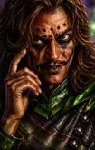
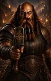

# Returning NPC Portrait Gallery

[← Back to README](../README.md)

The gallery shows two portrait variants:

- **L** - character record/inventory (base portrait)
- **r** - additional portrait at the Infinity UI inventory screen (zoomed out)

Click a thumbnail to view the full-size portrait.

| L | r | L | r |
|:---:|:---:|:---:|:---:|
| **Ajantis** |  | **Alora** |  |
|  |  |  |  |
| **Branwen** |  | **Coran** |  |
|  |  |  |  |
| **Dynaheir** |  | **Eldoth** |  |
|  |  |  |  |
| **Faldorn** |  | **Garrick** |  |
|  |  |  |  |
| **Kagain** |  | **Khalid** |  |
|  |  |  |  |
| **Kivan** |  | **Montaron** |  |
|  |  |  |  |
| **Quayle** |  | **Safana** |  |
|  |  |  |  |
| **Shar-Teel** |  | **Skie** |  |
|  |  |  |  |
| **Tiax** |  | **Xan** |  |
|  |  |  |  |
| **Xzar** |  | **Yeslick** |  |
|  |  |  |  |
| **Yoshimo (ToB)** |  |  |  |
|  |  |  |  |
